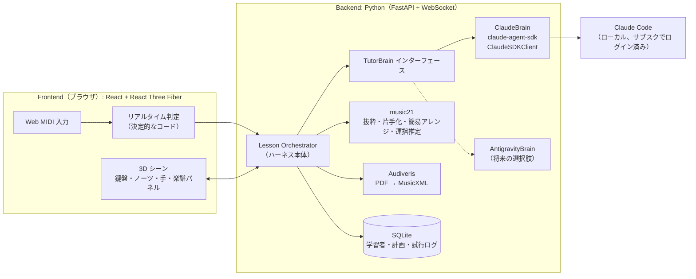

# ハッカソン計画

## 狙い

「PDF を 1 枚ドロップするだけで、3D の先生が自分専用のレッスンを始める」。
実用性より、デモの驚きを最大化する。

## デモシナリオ（3〜5 分）

1. **PDF をドロップする**
   楽譜ページが 3D 空間に浮かび、音符が光の粒として抜け出して鍵盤上のノーツに変わる（読み取り処理の演出）。
2. **先生が曲を分析する**
   Claude が「ハ長調・4/4・全 32 小節。サビは 17 小節目からですね」と、音声付きで話しかける。
3. **ヒアリング**
   「どこまで弾けるようになりたい？ ピアノ歴は？」→「サビだけ、ほぼ初心者」と答える。
4. **指導計画を表示する**
   3D 空間にステップがロードマップ状に並ぶ（右手メロディ → 左手ルート → 両手 → 原曲テンポ）。
5. **お手本を見せる**
   半透明の 3D の手が実際に鍵盤を弾く。指くぐりの場面ではカメラが手元にズームする。
6. **ユーザーが弾く**
   ノーツが 3D で落ちてきて、正しく押すと鍵盤が光ってパーティクルが出る。ミスは赤く光る。
7. **その場で講評する**
   「音は全部合ってる！ ただ 3 小節目で走ってるので、テンポを 70 に落としてもう一回」。
   練習内容が自動で組み替わる。
8. **（締め）** 簡単アレンジ版から原曲へ段階的に戻る様子を早送りで見せる。

## アーキテクチャ（Agent Native App 方式）

アプリ本体がハーネスとして全体を制御する。裏では、ユーザーがサブスク契約している Claude Code を SDK 経由で動かす。
MCP サーバーは立てない。アプリが「いまの状況」を渡し、エージェントは「次にやること」を JSON で返す。



### ハーネスとエージェントの役割分担

1. **Orchestrator** が、試行結果、現在の課題、学習者情報をまとめて、エージェントに 1 メッセージとして渡す。
2. **エージェント** は、決められた JSON スキーマで「次の行動」を返す。

   ```json
   {
     "say": "音は全部合ってる！3小節目で走ってるからテンポ70でもう一回",
     "action": "retry",
     "exercise": { "measures": [1, 4], "hand": "right", "tempo": 70, "simplify": "none" },
     "plan_update": null
   }
   ```

3. Orchestrator がそれを実行する。music21 で抜粋した楽譜を作り、画面を更新し、`say` の内容を読み上げる。

- エージェントの組み込みツールは基本的にオフにする（速くて安全）。PDF を読ませるときだけ Read を許可する。
- エージェントの出力は、スキーマで検証する。検証に失敗したら、エラー内容を付けて 1 回だけ再生成させる。

### セッションとコンテキストの保持

- `claude -p` を毎回呼ぶ方式ではなく、`ClaudeSDKClient` で 1 レッスンにつき 1 本のプロセスを起動したままにする。
  - 会話の文脈は自然に残る。
  - 起動の待ち時間も初回だけで済む。
- 日をまたぐ再開には、session_id を DB に保存して resume する。
- 念のため、レッスン終了時に「学習者メモ」（得意・苦手、進捗）をエージェントに要約させて DB に残す。履歴が長くなりすぎた場合や、セッションが壊れた場合でも、このメモから再開できる。

### プロバイダの差し替え

プロバイダはレッスン開始時に選ぶ。途中で切り替えることは想定しない。

```python
class TutorBrain(Protocol):
    async def start(self, system_prompt: str, resume_id: str | None) -> str: ...  # session_id を返す
    async def ask(self, message: str) -> AsyncIterator[BrainEvent]: ...          # テキストの差分と、最終的な JSON
    async def close(self) -> None: ...
```

- 今回は `ClaudeBrain` だけを実装する。
- ハーネスとエージェントのやり取りは「テキストを渡して JSON を受け取る」だけ。そのため、別の SDK（Antigravity など）でもこのクラスを 1 つ足すだけで対応できる。

### 鍵盤の汎用化

- 初回セットアップで「一番左と一番右の鍵盤を押してください」と案内し、音域を自動で検出する。プリセット（25 / 37 / 49 / 61 / 76 / 88 鍵）からも選べるようにする。
- 3D の鍵盤は、検出した音域に合わせて生成する。
- 音域外の音は、オクターブ移動で範囲内に収める。それでも無理な場合は、アレンジ生成側に音域の制約として渡す（エージェントにも音域を伝える）。
- 強弱の判定に備えて、velocity のキャリブレーション（弱・中・強を 1 回ずつ弾く）を任意で行えるようにする。

### PDF 入力（「渡すだけ」を実現する）

- **音符データ**: Audiveris（OMR）で MusicXML に変換する。
- **曲の構造**: Claude が PDF をそのまま画像として読み、タイトル、テンポ表記、リハーサルマーク、繰り返し記号、サビの位置などを把握する。
- 上の 2 つの結果をつき合わせて、曲の構造データを作る。
- **デモの保険**: 当日使う曲は事前に変換を検証し、結果をキャッシュしておく。ネットワーク障害に備えて、LLM の応答を再生するモードも用意する。

### 3D 表現（クオリティ最優先）

- **技術**: React Three Fiber、drei、postprocessing（Bloom、被写界深度、トーンマッピング）。
- **鍵盤**: PBR マテリアル（黒鍵は艶あり、白鍵は少しだけ透明感を持たせる）。押下は物理的なスプリングアニメーションで表現する。
- **ノーツ**: 鍵盤の奥から落ちてくる、発光するバー。正解時は鍵盤に吸い込まれてパーティクルが弾ける。
- **手**: 手続き的に生成するホログラム風の手を使う（詳細は DESIGN.md §11.3）。
- **カメラ**: シーンに応じて自動で移動する（全体 → 手元クローズアップ → 楽譜パネル）。
- **楽譜パネル**: 抜粋した楽譜を Verovio で SVG に描き、3D 空間内のパネルに表示する。演奏中の位置をハイライトする。
- **先生の声**: Irodori-TTS で話す（詳細は DESIGN.md §12.1）。

## 実装の優先順位

1. 3D の鍵盤、ウォーターフォール、MIDI 入力、判定（デモの土台。MusicXML を直接読み込める状態にする）
2. `ClaudeBrain` と Orchestrator、ヒアリングから計画と講評までのループ
3. 抜粋と片手化、楽譜パネル
4. 3D の手によるお手本演奏
5. PDF 入力（Audiveris と Claude による構造解析）
6. 演出の強化（パーティクル、カメラワーク、音声）
7. 簡易アレンジ

## 未決事項

- ハッカソンの締切と使える時間、チームの人数
- デモで使う曲（著作権を考えると、パブリックドメインの曲が無難）
