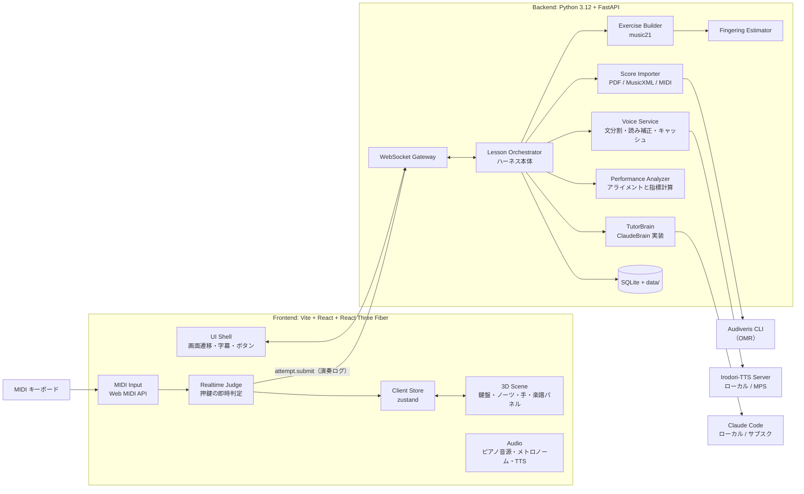
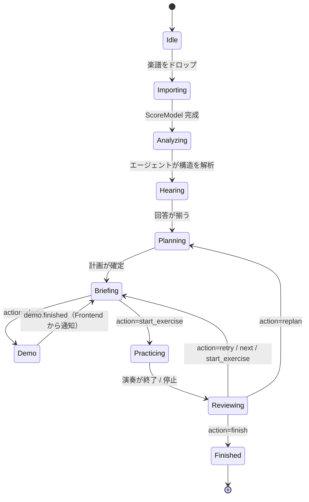
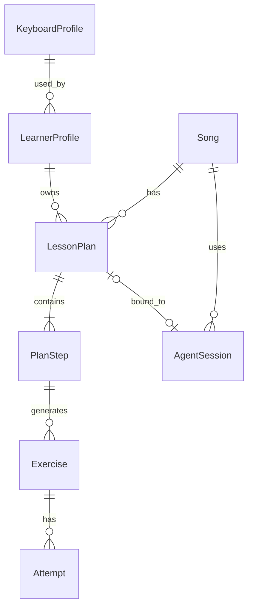
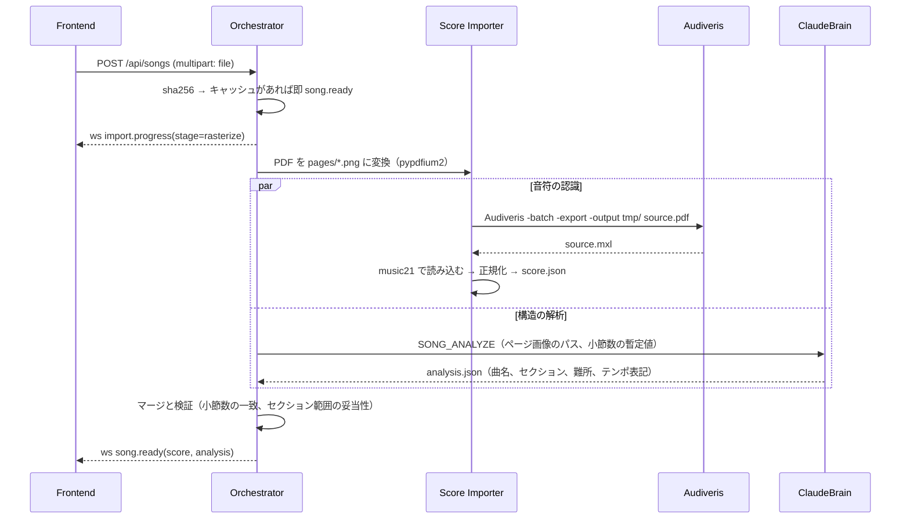
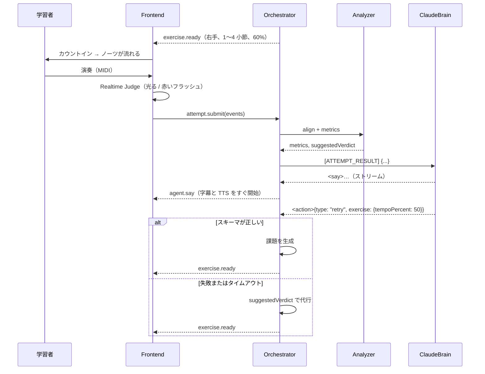

# piano-coach 設計

最終更新: 2026-10-15
関連: [00-brainstorm.md](00-brainstorm.md) / [01-hackathon-plan.md](01-hackathon-plan.md)

## 1. 背景と目的

ピアノ初心者は、弾きたい曲があっても何から手をつければよいか分からず、多くが挫折する。
piano-coach は、楽譜の PDF を渡すだけで AI が専属の先生になるアプリである。学習者のレベルと目的に合わせて指導計画を立て、MIDI キーボードの演奏をその場で判定し、付きっきりで指導する。
今回はハッカソン向けのデモとして、「すげぇ、こんなことできるんだ」と思わせることを最優先にする。

## 2. スコープ

### やること（ハッカソン MVP）
- PDF（または MusicXML / MIDI）の取り込みと、曲構造の自動解析
- 音声付きのヒアリングと、指導計画の自動作成
- 練習課題の自動生成（小節範囲、片手、テンポ、簡易アレンジ）
- 3D シーンでの表示（鍵盤、落ちてくるノーツ、楽譜パネル、お手本を弾く 3D の手）
- MIDI 入力のリアルタイム判定と、演奏後の詳細分析
- エージェント（Claude）による講評と、次の課題の決定

### 最初に完成させる一本道（デモの最小完成形）
レビュー（docs/reviews/codex-astra-review.md）の指摘 8 を受けて、まずは次の一本道を最後までつなぐ。その後に機能を広げる。
- 曲: メヌエット ト長調 BWV Anh.114 の 1〜8 小節（assets/scores/minuet-g）。取り込みは、検証済みのキャッシュから行う
- 鍵盤: JUNO-DS88
- 運指: 読み込み時にエージェントが設計する（§8.3）
- 流れ: ヒアリング → 計画 → お手本（3D の手）→ 右手を wait → 右手を play → 講評 → テンポ変更 → 両手
- 声、字幕、先生オーブ、応答の再生モードは、この一本道の時点で入れる

### やらないこと
- 複数ユーザー、ログイン、クラウド配信（自分用のローカルアプリ）
- マイクで録った生ピアノの音声認識（MIDI 入力のみ）
- Web カメラでの手のトラッキング（将来の拡張）
- レッスン途中でのエージェントのプロバイダ切り替え

## 3. 要件

### 3.1 機能要件

**楽譜の取り込み**
- F-01 PDF をドラッグ＆ドロップで取り込める。MusicXML（.musicxml / .mxl）と MIDI も取り込める
- F-02 取り込んだ楽譜から、音符データ、拍子、調、テンポ、小節構成を得られる
- F-03 エージェントが楽譜を読み、曲名、セクション（イントロ / A メロ / サビなど）、難所を推定できる
- F-04 一度取り込んだ曲はキャッシュされ、再取り込みは即時に終わる

**ヒアリングと指導計画**
- F-10 取り込み後、エージェントが学習者に目的とレベルをヒアリングできる。目的は「全部弾きたい」「サビだけ」など
- F-11 回答はボタン選択か自由入力で行える
- F-12 エージェントが指導計画（ステップの列）を作り、3D のロードマップとして表示できる
- F-13 練習の結果に応じて、エージェントが指導計画を途中で組み替えられる

**練習**
- F-20 1 つの練習課題は、小節範囲、手（右 / 左 / 両手）、テンポ、簡易アレンジのレベル、練習モードで決まる
- F-21 練習モードは次の 3 種類
  - お手本（watch）: 3D の手と音で見本を見せる
  - 待機（wait）: 正しい鍵盤を押すまでノーツが止まる
  - 本番（play）: 一定テンポで流れ、そのまま判定する
- F-22 課題の範囲だけを抜き出した楽譜を、楽譜パネルに表示できる
- F-23 メトロノームとカウントイン（1 小節）を鳴らせる
- F-24 ノーツに運指番号を表示できる

**判定と講評**
- F-30 押鍵ごとに、正誤とタイミングを 1 フレーム以内に画面へ反映する
- F-31 演奏の終了後、次の項目を数値化する: 音の正確さ、タイミングのずれ、テンポの安定性、強弱、和音の揃い、ペダル
- F-32 数値化した結果をもとに、エージェントが講評を返し、次の行動を決める。行動は「もう一回」「次へ」「課題の変更」「お手本」「計画の変更」のいずれか
- F-33 先生の発話（講評、次の課題の指示、ヒアリングの質問）は、すべて Irodori-TTS の声で読み上げ、字幕でも表示する（例:「次は右手だけで 1〜4 小節を弾いてみましょう！」）

**鍵盤**
- F-40 接続された MIDI 入力デバイスを自動で検出する
- F-41 最低音と最高音の鍵盤を押すと、鍵盤の音域を設定できる。25 / 37 / 49 / 61 / 76 / 88 鍵のプリセットも選べる
- F-42 音域外の音は、オクターブ移動で音域内に収めて提示する
- F-43 任意で velocity のキャリブレーション（弱・中・強）ができる

**デモ支援**
- F-50 デモ曲は事前に取り込んだキャッシュから即座に読み込める
- F-51 エージェントの応答を記録し、再生するモードがある（ネットワーク障害時の保険。デモの台本に限る。§10.5）
- F-52 起動時に「デモ準備」画面を出す。ここで次を確認する:
  - 音声の開始（ブラウザの制約により、クリックで `Tone.start()` を呼ぶ必要がある）
  - ピアノ音源の読み込み完了
  - MIDI 入力ポートの選択と、実際の打鍵テスト
  - 先生の声のテスト再生
  - Claude Code と Irodori の接続状態（`/api/health`）
- F-53 MIDI の接続が切れたら、演奏を止めて、押鍵とペダルの状態を解除する。再接続したら、カウントインから再開する

### 3.2 非機能要件

| 項目 | 目標 |
|---|---|
| 押鍵から画面反映まで | 16ms 以下（1 フレーム） |
| 描画のフレームレート | 60fps 以上（Apple Silicon の Mac、1440p） |
| エージェントの初回発話 | 字幕は 3 秒以下、声は 4 秒以下で開始する（1 文目から順に音声化する） |
| エージェントの応答完了 | 10 秒以下（講評 1 回あたり） |
| PDF の取り込み | 4 ページで 90 秒以下（待ち時間は演出で埋める） |
| エージェント失敗時 | ルールベースのフォールバックで、レッスンを止めない |
| 動作環境 | macOS（Apple Silicon）、Chrome の最新版。Claude Code にサブスクでログインしていること |

## 4. 全体構成



| コンポーネント | 責務 |
|---|---|
| UI Shell | 画面遷移、字幕、ヒアリングのボタンを担う。サーバーからのイベントを Store に反映する |
| 3D Scene | 表示に専念する。Store の状態と再生時刻だけを見て描画し、ロジックは持たない |
| MIDI Input | Web MIDI でデバイスを列挙し、note on/off と CC64（ペダル）を時刻付きで発行する |
| Realtime Judge | 押鍵を、予定ノーツとその場で照合して即時判定する。演奏ログを記録する |
| Audio | Tone.js でピアノのサンプル音源とメトロノームを鳴らす。先生の音声を順に再生し、再生中は BGM とメトロノームの音量を下げる |
| WebSocket Gateway | フロントとの双方向通信を担う。イベントの定義は §10 |
| Lesson Orchestrator | レッスンの状態機械を持つ。エージェントへの入力を組み立て、エージェントの出力を検証して実行する |
| TutorBrain | エージェントとのやり取りを抽象化したもの。今回は ClaudeBrain だけを実装する |
| Score Importer | 楽譜を内部表現（ScoreModel）に変換する。PDF の場合は Audiveris と、エージェントによる構造解析を使う |
| Exercise Builder | 課題の仕様から、抜粋・片手化・簡易アレンジ・移調した楽譜を生成する |
| Performance Analyzer | 演奏ログを課題の楽譜とアライメントし、指標を計算する |
| Fingering Estimator | 運指がない音符に運指を推定して付ける |
| Voice Service | 先生の発話を文ごとに Irodori-TTS で音声化し、キャッシュして配信する。失敗したら Web Speech API に切り替える |

**状態の所有者**
- 楽譜、計画、試行の結果: Backend（SQLite）
- 再生時刻と押鍵状態: Frontend
- 会話の文脈: Claude Code のセッション（ただし、失っても学習者メモから再構成できる）

## 5. レッスンの状態遷移



- 「Briefing」は、課題の説明を読み上げてカウントインを待つ状態。
- **演奏の開始条件**: Briefing から Practicing に移るのは、次の 3 つがそろったときだけ。
  1. `exercise.ready` を受信している
  2. 先生の発話がすべて再生し終わっている（Frontend から `voice.done` を通知する）
  3. 学習者が開始の操作をした（どの鍵盤でもよいので 1 回押す、または開始ボタン）
- **エージェント呼び出しの直列化**: 1 つのレッスンでは、エージェントへの要求を同時に 1 つしか流さない。演奏中に来た自由入力はキューにためる。
- **古い応答の破棄**: 課題には版番号 `exerciseVersion` を付ける。要求を送った時点の版と現在の版が違う応答や音声は、適用せずに捨てる。
- **通信が切れた場合**: 演奏を止める。再接続したら、同じ課題の Briefing に戻る。
- どの状態からでも、ユーザーは自由入力でエージェントに話しかけられる（例:「もう少しゆっくりにして」）。

## 6. データモデル

### 6.1 永続化

- SQLite（`data/app.db`）: メタデータと履歴を置く。
- ファイル（`data/songs/<song_id>/`）: 楽譜本体を置く。

```
data/
  app.db
  songs/<song_id>/            # song_id = 元ファイルの sha256 の先頭 12 文字
    source.pdf | source.mxl | source.mid
    pages/page-1.png ...      # PDF を 150dpi で画像化したもの（エージェントと 3D 演出に使う）
    score.musicxml            # 正規化済みの MusicXML
    score.json                # ScoreModel
    analysis.json             # エージェントによる構造解析
    exercises/<exercise_id>.musicxml
  replays/<session_id>.jsonl  # エージェント応答の記録（デモ用の再生モードに使う）
```

### 6.2 エンティティ



| エンティティ | 主なフィールド |
|---|---|
| Song | id, title, composer, source_type, key, time_sig, tempo_bpm, measure_count, sections(json), created_at |
| LearnerProfile | id, level（beginner / novice / intermediate / advanced）, can_read_score（bool）, notes（学習者メモ、エージェントが更新）, keyboard_profile_id |
| KeyboardProfile | id, device_name, low_note, high_note, velocity_curve(json), latency_offset_ms |
| LessonPlan | id, song_id, learner_id, goal（自由文）, target_range（小節範囲）, status, created_at |
| PlanStep | id, plan_id, order, title, description, exercise_template(json), status（todo / doing / done / skipped） |
| Exercise | id, step_id, spec(json, ExerciseSpec), musicxml_path, notes(json) |
| Attempt | id, exercise_id, mode, started_at, events(json, 演奏ログ), metrics(json), agent_verdict |
| AgentSession | id, purpose（analysis / lesson）, song_id, plan_id（nullable: ヒアリング中はまだ計画がない）, provider, provider_session_id, model, status, last_active_at |

学習者は 1 人を想定するが、テーブルは分けておく（コストはほぼない）。

### 6.3 ScoreModel（楽曲の内部表現）

MusicXML は扱いにくいので、フロントと判定ではこの JSON だけを使う。

```ts
type ScoreModel = {
  songId: string;
  ppq: 480;                         // 拍の分解能
  timeSignatures: { tick: number; num: number; den: number }[];
  tempos: { tick: number; bpm: number }[];
  keySignatures: { tick: number; fifths: number; mode: "major" | "minor" }[];
  measures: { index: number; startTick: number; endTick: number; pickup?: boolean }[];  // index は 1 始まり。弱起の小節は index 0 と pickup=true
  notes: ScoreNote[];
  dynamics: { tick: number; mark: "pp"|"p"|"mp"|"mf"|"f"|"ff"; staff: 1|2 }[];
  hairpins: { startTick: number; endTick: number; type: "cresc"|"dim"; staff: 1|2 }[];
  pedals: { startTick: number; endTick: number }[];
};

type ScoreNote = {
  id: string;            // "m3-s1-v1-n2" のように、元の位置を表す
  pitch: number;         // MIDI ノート番号
  startTick: number;
  durationTick: number;
  staff: 1 | 2;          // 1 = 右手、2 = 左手（ピアノ譜の大譜表を前提にする）
  voice: number;
  measure: number;
  finger?: 1|2|3|4|5;    // 楽譜由来の運指、または推定値
  fingerSource?: "score" | "agent" | "estimated";  // score = 楽譜に印刷、agent = エージェントが設計し検証済み、estimated = 検証に通らなかったもの
  tieStart?: boolean; tieStop?: boolean;
};
```

- 判定と描画は tick を基準に行い、テンポの倍率を掛けて秒に変換する。
- タイで結ばれた音は 1 音にまとめた上で、判定の対象にする。

## 7. 楽譜の取り込み



- **正規化**
  - 2 段（大譜表）以外の楽譜は対象外とし、警告を出す。
  - 装飾音は判定の対象外にする（表示のみ）。
  - 繰り返し記号は、MVP では展開しない。セクションの指定で対処する。
- **検証で不整合があった場合**（Audiveris とエージェントで小節数が違うなど）は、Audiveris の結果を正とする。エージェントのセクション指定は、範囲を丸めて採用する。
- **失敗時**: Audiveris が失敗した場合は、「MusicXML か MIDI を渡してください」と案内する。デモ曲は事前に検証したキャッシュを使う。
- **演出**: 待ち時間には、ページ画像を 3D 空間に浮かべる。進捗イベントに合わせて、音符が粒子になって鍵盤へ流れ込む演出を見せる（実際の ScoreModel が届いたらノーツに変形させる）。

## 8. 練習課題（Exercise）

### 8.1 ExerciseSpec

エージェントは仕様だけを決める。楽譜の生成は、Exercise Builder が決定的に行う。

```ts
type ExerciseSpec = {
  measures: [number, number];          // 開始と終了の小節（両端を含む）
  hand: "right" | "left" | "both";
  tempoPercent: number;                // 原曲テンポに対する割合（30〜120）
  mode: "watch" | "wait" | "play";
  simplify: "none" | "melody_only" | "bass_root" | "block_chords" | "rhythm_simple";
  loop: number;                        // 繰り返し回数（1〜8）
  metronome: boolean;
  focus?: string;                      // 学習者に見せる一言（例:「親指くぐりに注目」）
};
```

### 8.2 簡易アレンジのルール（music21 で実装する）

| 優先度 | simplify | 処理 |
|---|---|---|
| MVP | none | そのまま |
| MVP | melody_only | 右手は各時刻の最高音だけを残す。左手は除外する |
| MVP | bass_root | 左手は各拍の頭の最低音だけを残し、長さを次の音まで伸ばす |
| 後回し | block_chords | 左手のアルペジオなどを、1 拍目にまとめた和音に置き換える（同じ小節・同じ和声の音を集約する） |
| 後回し | rhythm_simple | 16 分音符以下の細かいリズムを 8 分音符に量子化する。装飾的な音を削る |

- 音域外の音は、オクターブ単位で音域内に移す。移せない音は削除し、警告に残す。
- 運指がない音には、Fingering Estimator が運指を付ける。

### 8.3 運指の設計（エージェントが行う）

運指は人もルールも決めない。楽譜を読み込んだ時点で、エージェントが設計する。

**タイミング**
- ScoreModel ができたら、専用の「運指セッション」（使い捨て）をすぐに開く。ヒアリングと並行して、裏で設計させる。
- デモで最初に使う範囲（ヒアリング前なので、曲の先頭 8 小節）を先に依頼し、残りを後から依頼する。お手本の再生を待たせないため。
- 待っている間は、3D 上で「先生が指使いを考えています」という演出を出す。ノーツに運指番号が順に灯っていくように見せる。

**入力**（手ごとに、小節単位のコンパクトな表記で渡す）

```
key: G major, time: 3/4, tempo: 100
[RIGHT] m1: n1 D5 b1 q | n2 G4 b2 e | n3 A4 b2.5 e | n4 B4 b3 e | n5 C5 b3.5 e
[LEFT]  m1: n40 G3+B3+D4 b1 h. ...
fixed: n1=5            # 楽譜に印刷されている運指があれば、固定の制約として渡す
```

**出力**（SDK の `output_format` を使う）

```json
{
  "fingering": [{ "id": "n1", "finger": 5 }, { "id": "n2", "finger": 1 }],
  "events": [{ "noteId": "n7", "type": "thumb_under", "measure": 2, "tip": "親指を3の指の下にくぐらせて" }]
}
```

- `events` の type は `thumb_under`（親指くぐり）、`finger_over`（指越え）、`position_shift`（手の移動）、`stretch`（広げる）のいずれか。
- `events` は、3D の手のスロー再生とカメラのクローズアップのきっかけに使う。先生の解説（「ここで親指くぐりだよ」）にも使う。

**検証**（Orchestrator が機械的に行う）
- すべての音に 1〜5 の指が付いている。
- 和音の中では、指が重複していない。指の順序が音の高さと矛盾しない（右手は低い音ほど小さい番号、左手は逆）。
- 連続する 2 音の間隔が、その 2 本の指で届く範囲に収まっている。上限は表で持つ（例: 1-2 の指で 9 半音、1-5 で 12 半音、2-3 で 4 半音）。
- 同じ指で、違う鍵盤を 8 分音符より短い間隔で連続して弾いていない。

違反があった場合は、違反の一覧を添えて 1 回だけ作り直させる。それでも残る違反は、その音を `fingerSource: "estimated"` にして、ゴーストの手の表示だけにする。

**簡易アレンジの課題**: 音が変わる課題（`melody_only` など）は、その課題用に運指を依頼し直す。結果は課題の内容のハッシュでキャッシュする。

### 8.4 演奏用タイムライン（ExerciseTimeline）

Exercise Builder は、課題ごとに演奏用のデータを 1 回だけ生成する。判定、音、ノーツ、3D の手は、すべてこのデータを共通で使う。

```ts
type ExerciseTimeline = {
  exerciseId: string;
  exerciseVersion: number;
  countInTicks: number;               // カウントイン 1 小節分。弱起の場合はその分を差し引く
  bpmQuarter: number;                 // 四分音符基準に正規化したテンポ（tempoPercent を適用済み）
  notes: {
    playId: string;                   // 演奏用の一意な ID（ループ回数ごとに別になる）
    sourceNoteId: string;             // ScoreNote.id
    measure: number;                  // 元の小節番号（講評や楽譜パネルの表示に使う）
    loopIndex: number;                // 何周目か（0 始まり）
    pitch: number; startTick: number; durationTick: number;  // 課題の先頭を 0 とする
    hand: "right" | "left"; finger?: 1|2|3|4|5;
  }[];
};
```

- 時間の原点は、課題の先頭（カウントインの直後）を 0 とする。原曲の tick は使わない。
- 範囲の先頭で、前の小節からタイでつながっている音は、新しい打鍵として扱う。範囲の末尾でタイが続く音は、範囲の終わりで切る。
- 繰り返し記号は展開しない。課題の範囲は、繰り返し記号をまたがない区間に限る（範囲を検証して、違反していたら Builder がエラーを返す）。
- 生成結果が 0 音の場合はエラーにする（例: 左手の課題で `melody_only` を指定した場合）。

## 9. 判定と分析

### 9.1 リアルタイム判定（Frontend）
- 判定窓
  - 予定時刻から ±80ms 以内: perfect
  - ±160ms 以内: good
  - それより外: miss
- **割り当て**: 押鍵は、まだ消費されていない同じピッチの予定音のうち、時刻が最も近いものに 1 対 1 で割り当てる。窓内に候補がなければ extra にする。予定時刻から +160ms を過ぎても押されなかった予定音は miss に確定する。
- **wait モード**: 時間では判定しない。次の予定時刻の音（和音）が、その時点以降の新しい押鍵ですべてそろったら進む。押しっぱなしの鍵盤は数えない。同じ音の連打には、いったん離鍵してからの再打鍵を要求する。
- 余計な押鍵は extra として記録する（赤いフラッシュで表示する）。
- note on と note off、CC64 は、`MIDIMessageEvent.timeStamp`（受信時刻。`performance.now()` と同じ時間軸）で演奏ログに記録する。イベントハンドラが動いた時刻は使わない（描画の負荷による遅れを、演奏の遅れと誤認しないため）。
- **時刻基準を 1 つにする**: 課題の開始時刻（カウントイン終了の瞬間）を `t0` として、同じ `performance.now()` 基準で記録する。演奏ログは `t0` からの相対時刻で送る。メトロノームやお手本の音（Tone.js の AudioContext 時刻）は、`t0` に合わせてスケジュールする。
- **レイテンシの補正**: お手本やメトロノームの音が実際に聞こえる時刻は、`AudioContext.getOutputTimestamp()` で `performance.now()` の時間軸に対応付ける。そのうえで残る個人差だけを `latencyOffsetMs` とする。オフセットは、セットアップ時に 8 拍のクリックに合わせて弾いてもらい、ずれの中央値を取って決める。判定（Frontend）と分析（Backend）は、同じ補正値を使う。

### 9.2 演奏後の分析（Backend: Performance Analyzer）
1. **アライメント**: 演奏ログと予定ノーツを、ピッチの一致と時間の近さで対応付ける。DTW を使い、和音はオンセットのクラスタとして扱う。
2. **指標**: 下の表のとおり計算する。

| 指標 | 定義 |
|---|---|
| pitchAccuracy | 正しく弾けた音の数 ÷ 予定ノーツ数 |
| missed / extra | 弾き漏れた音の数 / 余計に弾いた音の数（小節ごとにも集計） |
| timingMeanMs / timingStdMs | オンセットのずれの平均と標準偏差（テンポのずれを補正した後の値） |
| tempoDrift | 実際の拍間隔を線形回帰した傾き（走り / もたり） |
| tempoRatio | 実際のテンポ ÷ 指定テンポ |
| chordSpreadMs | 和音を構成する音のオンセットのばらつき |
| dynamicsMatch | 強弱記号やクレッシェンドから期待される velocity の傾向と、実際の velocity の相関 |
| legatoRatio | 隣り合う音が重なった時間の比率（レガートの度合い） |
| pedalMatch | 楽譜のペダル区間と CC64 区間の一致率 |
| weakSpots | 誤りやずれが大きい小節と拍の上位 3 件 |

3. **モードによる違い**: wait モードでは、タイミング系の指標（timing*、tempo*、legato）を算出しない。代わりに「待たせた時間の合計」と「誤打鍵の数」を出す。watch モードは判定しない。
4. **強弱記号がない、または 1 種類しかない区間**では、dynamicsMatch を null にする（相関が定義できないため）。
5. **ルールベースの推奨判定**（`suggestedVerdict`）: エージェントには参考情報として渡す。エージェントが失敗したときは、この判定がそのまま使われる。
   - play モード: pitchAccuracy ≥ 0.95 かつ extra ≤ 2 かつ timingStdMs ≤ 60 → `next`
   - wait モード: pitchAccuracy ≥ 0.95 かつ extra ≤ 2 → `next`（タイミングは条件に入れない）
   - pitchAccuracy < 0.7 → `retry`。ただし tempoPercent を 15 下げる（下限は 30）
   - 上のいずれでもない → `retry`
   - 途中で停止した演奏では `next` にしない

## 10. エージェント（TutorBrain）

### 10.1 方針
- Agent Native App 方式を取る。主導権は Orchestrator が持ち、エージェントは「状況を受け取って、次の行動を返す」だけの役にする。
- MCP サーバーは立てない。エージェントのツールはすべてのセッションで無効にする（`tools=[]`）。ページ画像は、`Read` ツールを使わず、メッセージの image content block（base64）で直接渡す（2026-10-15 に動作を確認）。
- セッションは 2 種類に分ける。
  - **解析セッション**（使い捨て）: SONG_ANALYZE 専用。ページ画像を読むので文脈が重くなる。メインの会話を汚さないよう、結果（analysis.json）だけを返して閉じる。
  - **レッスンセッション**（長寿命）: `lesson.start` で開き、ヒアリングから終了まで 1 本の ClaudeSDKClient を使う。レッスンセッションには、ページ画像ではなく analysis と ScoreModel の要約だけを渡す。
- 長いレッスンで文脈が溢れたときは、Claude Code の自動要約に任せる。セッションが壊れたときは、学習者メモから RESUME で再構成する。
- 自分で使う前提のため、ローカルにサブスクでログインした Claude Code で動かす。

### 10.2 インターフェース

```python
class TutorBrain(Protocol):
    async def open(self, *, system_prompt: str, resume_id: str | None, model: str) -> str: ...
    async def send(self, message: BrainInput) -> AsyncIterator[BrainEvent]: ...
    async def close(self) -> None: ...

BrainEvent = SayDelta(text: str) | ActionReady(action: AgentAction) | BrainError(reason: str)
```

- `ClaudeBrain` は、`claude-agent-sdk` の `ClaudeSDKClient` をラップする。
- 起動オプション（§10.7 の検証結果に基づく）

  ```python
  ClaudeAgentOptions(
      system_prompt=load("prompts/system.md"),  # Claude Code の既定プロンプトを置き換える
      model="sonnet",
      tools=[],                     # 組み込みツールを無効にする
      strict_mcp_config=True,       # 必須。これがないと claude.ai のコネクタ（Gmail 等）が自動で読み込まれる
      setting_sources=[],           # ~/.claude の設定、CLAUDE.md、フックを読まない
      include_partial_messages=True,# テキストの差分を StreamEvent で受け取る
      max_turns=1,                  # 1 回の入力に 1 回だけ応答させる
      resume=saved_session_id,      # 再開時のみ指定する
  )
  ```

- 起動時に、環境変数 `ANTHROPIC_API_KEY` が設定されていないことを確認する。設定されている場合は、警告を出して起動を止める（API 課金になるため）。
- `RateLimitEvent` の status が `allowed_warning` になったら、UI に残量の警告を出す。`rejected` になったら、ルールベースのモードに切り替える。
- ストリームで届いたテキストを `<say>` と `<action>` に切り分け、`SayDelta` と `ActionReady` に変換する。
- 将来、別の SDK に対応するときは、このクラスを足すだけで済むようにする。

### 10.3 入力（Orchestrator → エージェント）

1 メッセージは、種別ヘッダと JSON 本文からなる。

```
[ATTEMPT_RESULT]
{ "step": {...}, "exercise": {...ExerciseSpec}, "metrics": {...}, "suggestedVerdict": "retry",
  "attemptCountOnThisExercise": 3, "learner": { "level": "beginner", "canReadScore": false } }
```

| 種別 | タイミング | 主な内容 |
|---|---|---|
| SONG_ANALYZE | 取り込み時 | ページ画像（image content block）、小節数と拍子 |
| FINGERING | ScoreModel の完成直後（運指セッション） | 手ごとの音符列、固定の運指、範囲（§8.3） |
| SONG_LOADED | 解析の完了後 | ScoreModel の要約（小節ごとの音数・音域・リズム密度）、セクション |
| HEARING_ANSWER | ヒアリングの回答時 | 質問の ID と回答 |
| ATTEMPT_RESULT | 演奏の終了時 | 課題、指標、推奨判定、その課題での試行回数 |
| USER_MESSAGE | 自由入力 | テキスト |
| RESUME | セッションの再開時 | 学習者メモ、計画、直近の進捗 |
| WRAP_UP | レッスンの終了時 | 学習者メモの更新を依頼する |

**呼び出しの頻度**: ATTEMPT_RESULT は、`loop` 回の繰り返しがすべて終わったときに 1 回だけ送る。途中で停止した場合も 1 回送る。1 回の試行ごとの即時フィードバックは、Realtime Judge が担う。これで、利用上限と待ち時間を抑える。

楽譜の全音符は渡さず、要約だけを渡す（トークン節約のため）。必要な箇所は、エージェントが `request_detail` アクションで要求できる。

### 10.4 出力（エージェント → Orchestrator）

```
<say>音は全部合ってたよ！ただ3小節目でちょっと走ったね。テンポを少し落としてもう一回いこう。</say>
<action>{ "type": "retry", "exercise": { ... }, "ui": { "highlightMeasures": [3] } }</action>
```

`<say>` を先に出させることで、TTS と字幕をすぐに開始できる。

**出力形式の使い分け**
- レッスン中の応答（講評、次の課題）: タグ形式を使う。`<say>` を差分で受け取り、すぐ TTS に流すため。
- 計画の作成（`set_plan`）も、レッスンセッションの中ではタグ形式にそろえる。同じクライアントで出力形式を切り替えないため。
- 解析セッション（使い捨て）だけ、SDK の `output_format`（JSON Schema）を使い、`ResultMessage.structured_output` で受け取る。構造化出力でも、失敗して値が空で終わる場合があるので、結果の成否と値の有無を確認し、自前のスキーマでも検証する。

**AgentAction**（JSON Schema で検証する）

| type | ペイロード | Orchestrator の処理 |
|---|---|---|
| ask | question: { id, text, options?: string[], allowFree: bool } | ヒアリングの UI を表示する |
| set_plan | plan: { goal, targetRange, steps: [{ title, description, exerciseTemplate }] } | 計画を保存し、ロードマップを表示する |
| start_exercise | exercise: ExerciseSpec | 課題を生成し、Briefing に入る |
| demo | exercise: ExerciseSpec | 3D の手でお手本を再生する |
| retry | exercise?: ExerciseSpec（差分） | 同じ課題で再挑戦する（差分があれば適用する） |
| next | なし | 次のステップの exerciseTemplate で課題を開始する |
| replan | plan（同上） | 計画を差し替える |
| request_detail | measures: [a, b] | 該当範囲の全音符を返す |
| update_notes | notes: string | 学習者メモを更新する |
| finish | summary: string | レッスンを終了する |

共通の任意フィールド `ui` では、`highlightMeasures`、`cameraPreset`、`showFingering` を指定できる。

**検証のルール**（スキーマの検証に加えて行う）
- 現在の状態で許されるアクションかを確かめる（例: Practicing 中の `replan` は不可。最終ステップでの `next` は `finish` として扱う）。
- スキーマの enum には、実装済みの値だけを入れる（未実装の `block_chords` などは、スキーマから外す）。
- `retry` の差分は、適用した後の完全な ExerciseSpec として検証する。範囲と組み合わせのチェックや、0 音でないことの確認も行う（§8.4）。
- `request_detail` は、1 回の応答につき 1 回まで。
- 課題の具体的な指示（「次は右手、テンポ 50%」など）は、検証を通った課題から Orchestrator が定型文で生成して読み上げる。エージェントの `<say>` は講評と励ましに限る（読み上げた指示と、実際に適用された課題が食い違うのを防ぐため）。

### 10.5 失敗時の挙動
- 次の場合は、エラー内容を添えて 1 回だけ再生成させる: JSON が不正、スキーマに違反、存在しない小節を指定。
- 次の場合は、状態ごとに決めた代行処理に切り替える: 再生成でも失敗、または 20 秒でタイムアウト。このときの `say` は定型文にする。
  | 状態 | 代行処理 |
  |---|---|
  | Analyzing | キャッシュ済みの analysis.json を使う。ない場合は、セクションを「全体」1 つとする |
  | Hearing | 固定の 2 問（ピアノ歴、どこを弾きたいか）を、選択肢付きで出す |
  | Planning | 定型の計画を使う（右手 wait → 右手 play → 左手 → 両手。対象は選ばれた範囲の先頭 8 小節） |
  | Reviewing | `suggestedVerdict` に従う（§9.2） |
- 代行中もエージェントへの再接続を裏で試みる。復帰したら、次の要求から通常の処理に戻す。
- セッションが死んだ場合は、新しいセッションを開き、`RESUME` メッセージで文脈を戻す。
- すべての入出力を `replays/*.jsonl` に記録する。再生モードは、デモ用の台本（曲、課題、ヒアリングの回答を固定したもの）に限って使う。入力の種別に加えて、課題の ID と主要な指標の範囲が記録と一致した場合だけ、記録した応答を返す。一致しない場合は、ルールベースの判定に戻す。

### 10.6 プロンプト
- `prompts/system.md`: 先生のペルソナ、指導の原則、出力形式、AgentAction の仕様を書く。
  - 指導の原則の例: 1 回の指摘は 1 つだけ、まず褒める、楽譜が読めない人には音名と鍵盤の位置で説明する。
- `prompts/examples.md`: 入力と出力の例を 5 つ程度載せる（初心者のヒアリング、サビだけの計画、失敗が続いたときに課題を分割する、など）。
- モデルは設定で切り替えられるようにする。既定は、応答速度を重視して Sonnet 系とする。

### 10.7 SDK の検証結果（2026-10-15、claude-agent-sdk 0.2.166 / 同梱 CLI 2.1.299、Sonnet）

環境変数を空にした状態で、サブスクのログインだけを使って計測した（`RateLimitEvent` に `five_hour` が出るので、サブスクの枠で動いていることを確認できる）。

| 項目 | 結果 |
|---|---|
| 接続（初回） | 3.2 秒 |
| 接続（resume） | 0.8 秒 |
| 最初のテキスト差分まで | 1.0〜1.3 秒（ときどき 3 秒） |
| 1 往復の完了まで | 3.5〜5.5 秒 |
| 文脈の保持 | 3 往復後も、名前・レベル・前回の結果を保持した |
| resume | 別プロセスから同じ session_id で再開し、文脈を引き継いだ |
| 画像入力 | image content block で、ツールなしで読めた |
| output_format | `structured_output` に、スキーマどおりの JSON が返った（約 3 秒） |
| 1 往復あたりの文脈量 | 約 600〜1,400 トークン（`strict_mcp_config=True` の場合） |

**検証で見つかった落とし穴**
1. **`strict_mcp_config` を付けないと、claude.ai のコネクタが 2 往復目から自動で読み込まれる。** 約 300 個のツールが入り、文脈が約 21 万トークンに膨らんだ。応答も 8〜10 秒に遅くなった。さらに、先生役が Gmail の送信ツールなどを持ってしまう。必ず付けること。
2. **エージェントは、指示していないアクション名を勝手に作る**（`ask_song`、`practice_measure` など）。アクション名の列挙をプロンプトに明記し、スキーマで検証して再生成させる（§10.5）。
3. **入力のキーが曖昧だと誤解される。** `"weak": 3` は「3 番の指」と解釈された。入力の JSON は、`weakSpots: [{ "measure": 3, "beat": 2 }]` のように、意味が分かるキー名にする。

## 11. 3D 表現

### 11.1 シーン構成

| 要素 | 仕様 |
|---|---|
| 鍵盤 | KeyboardProfile の音域に合わせて生成する。白鍵は SSS 風の半透明 PBR、黒鍵はクリアコートで艶を出す。押下は、spring で 3 度回転させて沈ませる |
| ノーツ | 鍵盤の奥から手前へ流れる、発光するカプセル。色は右手がシアン系、左手がマゼンタ系。InstancedMesh で 1 回の draw にまとめる |
| ヒット演出 | perfect は鍵盤のリムライトとパーティクル、good は弱いリムライト、miss は赤いフラッシュとカメラの微振動 |
| 楽譜パネル | Verovio で描いた SVG をテクスチャにし、鍵盤の上空に浮かべる。再生位置のカーソルとハイライトを付ける |
| 3D の手 | 左右の手のモデル。お手本モードでは実体で、演奏中は半透明のゴーストで先行表示する |
| ロードマップ | 計画のステップを奥行き方向に並べた光の道。現在地にマーカーを置く |
| 環境 | 暗いスタジオ、HDRI による反射、床に反射（MeshReflectorMaterial） |
| ポストエフェクト | Bloom、被写界深度（クローズアップ時のみ）、ACES トーンマッピング、軽いビネット |

### 11.2 カメラプリセット
- `overview`: 鍵盤全体とロードマップを映す。
- `play`: 課題の音域を中心に、やや上から映す。
- `closeup`: 手元に寄る（指くぐりなどの解説時）。
- `score`: 楽譜パネルを正面から映す。

切り替えは 0.8 秒のイージングで補間する。エージェントは `ui.cameraPreset` で切り替えを指示できる。

### 11.3 手のアニメーション
- **アセット**: 手続き的に生成するホログラム風の手を採用する（外部アセットとリグが不要）。
  - 構造: 手のひら 1 つと、指ごとに 3 節（親指は 2 節と中手骨）のカプセルを、関節の球でつなぐ。
  - 質感: フレネル効果で縁を光らせた半透明のシェーダーに、走査線と弱いノイズを重ねる。Bloom で発光させる。
- **分かりやすさの工夫**（ホログラムでも、どの指で弾くかが一目で分かるようにする）
  - 指ごとに固定の色を割り当てる（1 = 赤、2 = 橙、3 = 黄、4 = 緑、5 = 青）。落ちてくるノーツも、担当の指の色で縁取る。「この色のノーツはこの指」と直感的に対応させるため。
  - 次に打鍵する指は、強く発光させ、指先に運指番号を浮かべる。それ以外の指は暗くする。
  - 指先から次の鍵盤へ、光のガイド線を引く。
  - 親指くぐりや指越えは、自動でスロー再生（0.5 倍）にし、カメラを `closeup` に寄せる。親指の通り道を、残像（トレイル）で見せる。
  - 演奏中は、左右の手のゴーストを半拍先行させて表示する。
- **入力**: 課題の音符と運指。
- **手首の位置**: 各時刻で押す指の鍵盤位置から、手首の目標位置を計算する。滑らかに追従させ、跳躍は 1 拍前から移動を始める。
- **指の動き**: 打鍵する指の先端を、鍵盤の表面に合わせる 2 ボーンの IK で動かす。打鍵の 120ms 前に持ち上げ、打鍵時に沈め、離鍵で戻す。
- **親指くぐりと指越え**: 運指の列から検出する。親指を手のひらの下に通すキーフレームを挿入し、手首を回転（回内）させる。
- **共通化**: 時刻 t の手の姿勢を返す純粋関数として実装する。再生、巻き戻し、スロー再生に共通で使う。

### 11.4 性能の予算
- draw call は 150 以下にする。ノーツと鍵盤はインスタンス化する。
- 楽譜パネルのテクスチャは、課題が変わるときだけ更新する。
- 判定と描画を分離する。判定は MIDI イベントのハンドラで行い、描画は Store を購読する。

## 12. 音
- **ピアノ音源**: Tone.js の Sampler で Salamander Grand Piano（CC-BY）を使う。お手本とプレビューで鳴らす。
- **学習者の打鍵**: キーボード本体が鳴るので、アプリは既定では鳴らさない（設定で切り替えられる）。
- **メトロノーム**: Tone.Transport と同期させる。カウントインは 1 小節。
- **先生の声**: §12.1 を参照。

### 12.1 先生の声（Irodori-TTS）

**採用モデル**: Irodori-TTS（Aratako 氏、日本語特化、MIT ライセンス）
- v4.1-Small の MeanFlow 蒸留版（`Aratako/Irodori-TTS-v4.1-Small-MF`）を採用する。速度は下の計測結果のとおりで、十分に実用的。

**計測結果（2026-10-15、M3 Pro / 18GB、MPS、fp32、v4.1-Small-MF）**

| 文 | 生成時間 | 音声の長さ | RTF |
|---|---|---|---|
| 「ナイス！」（4 文字） | 1.6 秒 | 1.3 秒 | 1.22 |
| 15 文字 | 2.1 秒 | 3.6 秒 | 0.58 |
| 29 文字 | 2.4 秒 | 5.5 秒 | 0.43 |
| 44 文字 | 2.7 秒 | 8.0 秒 | 0.34 |

- モデルの読み込みは、初回で 77 秒（ダウンロード込み）、2 回目以降で 12 秒。サーバーを常駐させて、読み込みは起動時の 1 回だけにする。
- 生成時間の内訳は、MeanFlow のサンプリングが約 0.5 秒、デコードが 0.3〜1.2 秒（文の長さに比例）、AI 生成音声の透かし（silentcipher）の埋め込みが約 0.6 秒。
- 参照音声を使う場合は、参照の準備に毎回約 0.35 秒かかる。参照音声の latent を事前に計算して `ref_latent` で渡せば、この時間を省ける。
- MPS で使える精度は fp32 のみ。
- 想定される体感: Claude の 1 文目（約 1〜2 秒）＋ 音声化（約 2 秒）で、声が出始めるまで約 3.5〜4.5 秒。2 文目以降は、再生中に生成が終わるので途切れない。
- 補足: `~/.cache/huggingface/token` に無効なトークンがあると、公開モデルでも 401 エラーになる。`HF_HUB_DISABLE_IMPLICIT_TOKEN=1` を付けて起動する。

**実行形態**: 別プロセスとしてローカルで常駐させる。
- Irodori-TTS-Server（OpenAI 互換の `/v1/audio/speech`）を、Apple Silicon の MPS で動かす。
- Voice Service は HTTP でこのサーバーを呼ぶ。

**声の一貫性**: 2026-10-15 の聴き比べで、キャプションだけで生成した声（参照音声なし）を採用した。
- キャプションは「明るく優しい20代女性のピアノの先生。落ち着いたテンポで、はきはきと話す。」とし、seed は固定（1234）する。
- 発話ごとに声質が揺れることが分かった場合の代替案: 気に入った出力を `voices/teacher.wav` として保存し、参照音声として使う（参照の latent は事前に計算しておく）。

他人の声を参照音声に使わない（モデルカードの倫理条項に従う）。

**低遅延化のパイプライン**
1. `SayDelta` を文末（。！？）で区切る。1 文がそろうたびに、すぐ音声化のキューに積む。LLM が話し終わるのを待たない。`</say>` が来た時点で、文末記号のない残りの文も送り出す。
   - 版番号が古くなった発話（§5）は、キューから捨てる。生成中のものも、結果を捨てる。
2. 音声化は 1 本のワーカーで順に処理する。音声化と再生を重ねて、2 文目以降は 1 文目の再生中に作っておく。
3. 生成した音声は、`(テキスト, 声, モデル)` のハッシュで `data/tts/*.wav` にキャッシュする。
4. 定型句は起動時に事前生成しておき、遅延ゼロで鳴らす。
   - 例:「ナイス！」「いいね！」「惜しい！」「もう一回いってみよう！」「次へ進みましょう！」「ワン、ツー、スリー、フォー」
   - 演奏直後は、まず定型の相づちを即座に鳴らし、その間にエージェントの講評を生成する（待ち時間を感じさせない）。

**読みと感情**
- Irodori は漢字の読みを誤ることがあるので、読み補正の辞書を通してから合成する。字幕は元の表記のままにする。
  - 例: 小節 → しょうせつ、運指 → うんし、和音 → わおん、右手 → みぎて、`3小節目` → さんしょうせつめ、BPM → ビーピーエム
  - **「弾く」は必ず置き換える。** 「はじく」と読まれることを確認した（2026-10-15）。ひらがなに置き換えると、正しく「ひく」と読まれた。
    - 弾く → ひく、弾いて → ひいて、弾き → ひき、弾け → ひけ、弾こう → ひこう、弾か → ひか
    - 「弾」が後ろに付く語は、置き換えの対象外にする（例: 連弾 → れんだん）。辞書は長い語から先に照合する。
- システムプロンプトでも、`<say>` は話し言葉で書き、難読漢字や英略語を避けるよう指示する。
- 感情は絵文字で制御する。エージェントには `<say>` に 1 文 1 個まで、決められた絵文字だけを使わせる（😊 褒める、🤔 考える、😮 驚く、💪 励ます）。字幕からは絵文字を除く。

**再生のルール**
- 学習者の演奏中（Practicing）は話さない。発話はキューにためて、演奏が終わってから再生する。ただし、カウントインの声だけは例外とする。
- 発話中は、BGM とお手本の音量を -12dB に下げる（ダッキング）。
- 3D シーンの「先生オーブ」（発光する球体）を、声の音量に合わせて脈動させる。誰が話しているかを視覚的に示すため。

**フォールバック**: 次の場合は、その文だけ Web Speech API（ja-JP）で読み上げる。
- Irodori サーバーに接続できない。
- 1 文の生成が 5 秒を超える。

## 13. インターフェース定義

### 13.1 HTTP

| メソッド | パス | 用途 |
|---|---|---|
| POST | /api/songs | 楽譜をアップロードする（multipart）。song_id を返す |
| GET | /api/songs/{id} | ScoreModel と analysis を返す |
| GET | /api/songs/{id}/pages/{n}.png | ページ画像を返す |
| GET | /api/exercises/{id}/score.svg | 抜粋した楽譜の SVG を返す（Verovio をサーバー側で使う場合） |
| GET | /api/tts/{hash}.wav | 先生の音声を返す（キャッシュ済みの wav） |
| GET | /api/health | Claude Code、Audiveris、Irodori-TTS の利用可否を返す |

サーバーは `127.0.0.1` にだけバインドする（ローカルの Claude Code を動かすため、外部には公開しない）。

### 13.2 WebSocket（`/ws`）

すべてのメッセージを `{ "type": string, "payload": object }` の形で送る。

| 方向 | type | payload |
|---|---|---|
| S→C | import.progress | stage, ratio |
| S→C | song.ready | song, score, analysis |
| S→C | agent.say | delta（文字列の差分）, final（bool） |
| S→C | voice.clip | utteranceId, seq, url, text, emotion, fallback（bool。true ならフロントで Web Speech を使う） |
| S→C | agent.ask | question |
| S→C | plan.updated | plan |
| S→C | exercise.ready | exercise, exerciseVersion, timeline（ExerciseTimeline）, scoreSvgUrl |
| S→C | demo.play | exerciseId, exerciseVersion（再生には exercise.ready の timeline を使う） |
| S→C | ui.hint | highlightMeasures, cameraPreset, showFingering |
| S→C | lesson.state | state（§5） |
| C→S | lesson.start | songId |
| C→S | hearing.answer | questionId, answer |
| C→S | user.message | text |
| C→S | attempt.submit | exerciseId, mode, t0, latencyOffsetMs, events[]（t0 からの相対 ms）, realtimeSummary, aborted |
| C→S | keyboard.profile | lowNote, highNote, deviceName, velocityCurve, latencyOffsetMs |
| C→S | voice.done | utteranceId（発話の再生が終わった） |
| C→S | demo.finished | exerciseId, exerciseVersion |
| C→S | practice.started | exerciseId, exerciseVersion, t0 |

### 13.3 ディレクトリ構成

```
piano-coach/
  apps/
    web/                  # Vite + React + R3F
      src/
        scene/            # Keyboard, Notes, Hands, ScorePanel, Roadmap, Effects, CameraRig
        midi/             # デバイス管理、Realtime Judge
        audio/            # Sampler, Metronome, TTS
        state/            # zustand の store、ws クライアント
        ui/               # 字幕、ヒアリング、HUD
    server/               # FastAPI
      piano_coach/
        api/              # http、ws
        lesson/           # orchestrator、state machine、fallback
        brain/            # base.py, claude.py, replay.py, prompts/
        score/            # importer, audiveris, model, exercise_builder, fingering
        analysis/         # aligner, metrics
        voice/            # splitter, yomi_dict, irodori_client, cache
  voices/teacher.wav      # 先生の声（参照音声）
        db/
  data/                   # 実行時に生成する（git 管理外）
  docs/
```

## 14. 主要シーケンス：練習ループ



## 15. 検討した代替案
- **MCP サーバーでツールを公開する**: エージェントが主導権を持つと、挙動がぶれて遅くなる。またデモの再現性が落ちるので、採用しない。
- **`claude -p` を毎回呼ぶ**: 起動のたびに数秒かかり、セッションの管理も手間なので、採用しない。
- **API キーで直接呼ぶ**: 指導のたびにコンテキストが大きくなり、料金が高くなる。自分用なので、サブスクで動かす方式を採る。
- **LLM に MIDI を直接評価させる**: 精度・速度・コストのいずれでも不利なので、採用しない。数値化はコードで行う。
- **LLM に楽譜（MusicXML）を生成させる**: 壊れた楽譜が出やすいので、採用しない。仕様だけを決めさせ、生成は music21 で行う。
- **ネイティブアプリ（Unity など）**: 楽譜の描画、MIDI、LLM 連携の部品が Web 側に揃っている。開発速度を優先して、Web 構成を採る。
- **Electron に包む**: デモは Chrome で十分なので、MVP では行わない。
- **Node のバックエンド**: music21 と Audiveris との連携が Python 側にあるので、言語を統一するため採用しない。

## 16. リスクと対策

| リスク | 影響 | 対策 |
|---|---|---|
| Audiveris の認識精度 | 取り込んだ楽譜が壊れる | デモ曲は事前に検証してキャッシュする。MusicXML を直接入力する経路を残す。不整合は検証で検出して警告する |
| エージェントの応答遅延とサブスクの利用上限 | デモ中に待たされる、止まる | `<say>` を先にストリーミングする。応答は講評のときだけにする。タイムアウト時はフォールバックする。再生モードを用意する |
| Claude Agent SDK の API の詳細 | 実装時の手戻り | 2026-10-15 に検証済み（§10.7）。SDK のバージョンを固定する |
| claude.ai コネクタの混入 | 文脈の肥大、遅延、意図しないツールの実行 | `strict_mcp_config=True`、`tools=[]`、`setting_sources=[]` を必ず指定する。init メッセージのツール数が 0 であることを起動時に検査する |
| 手のアニメーションの品質 | 見栄えが落ちる | ホログラム風の手を採用済み（§11.3）。手首の軌道は、運指から機械的に計算する |
| エージェントが設計した運指の誤り | 不自然なお手本になる | 機械的な検証と 1 回の再生成を行う。それでも違反が残る音は、ゴーストの表示にとどめる |
| Irodori-TTS の Mac での生成速度 | 声が遅れて会話のテンポが悪くなる | 計測済み（1 文 1.6〜2.7 秒）。文単位のパイプライン、定型句の事前生成、5 秒超で Web Speech に切り替える |
| Irodori の読み間違い | 不自然な発話になる | 読み補正の辞書、プロンプトでの表記ルール、デモの台本の事前確認 |
| Web MIDI の対応状況 | 入力できない | Chrome を前提にする。PC のキーボードで代わりに入力できるデバッグモードを用意する |
| 会場のネットワーク | エージェントが応答しない | テザリングを用意する。再生モードを用意する |
| 著作権 | デモ曲を公開できない | パブリックドメインの曲を使う |

## 17. 実装マイルストーン

| # | 内容 | 完了条件 |
|---|---|---|
| M0 | スパイク: Agent SDK と Irodori-TTS | 完了（2026-10-15）。§10.7 と §12.1 を参照 |
| M1 | 3D の鍵盤、ノーツ、MIDI、リアルタイム判定、デモ準備画面 | メヌエット 1〜8 小節を、play / wait モードで 60fps で遊べる |
| M2 | Orchestrator とエージェントのループ、先生の声、代行処理、再生モード | §2 の一本道が、声付きで最後まで通る。ネットワークを切っても止まらない |
| M3 | Exercise Builder と楽譜パネル | 片手化、テンポ、簡易アレンジが反映される |
| M4 | 3D の手とお手本 | デモ曲の課題で、手が破綻せずに弾く |
| M5 | PDF の取り込みと演出 | デモ曲の PDF から song.ready まで通る |
| M6 | 演出の仕上げ（先生オーブ、ダッキング、定型句） | デモシナリオを通しで 3 回、止まらずに完走する |

## 18. 未決事項
- （締切は 2026-10-16、一人で作る。今夜の作業順は docs/02-tonight-plan.md）
- 楽譜の SVG をサーバー側の Verovio で描くか、フロント側の Verovio（WASM）で描くか
