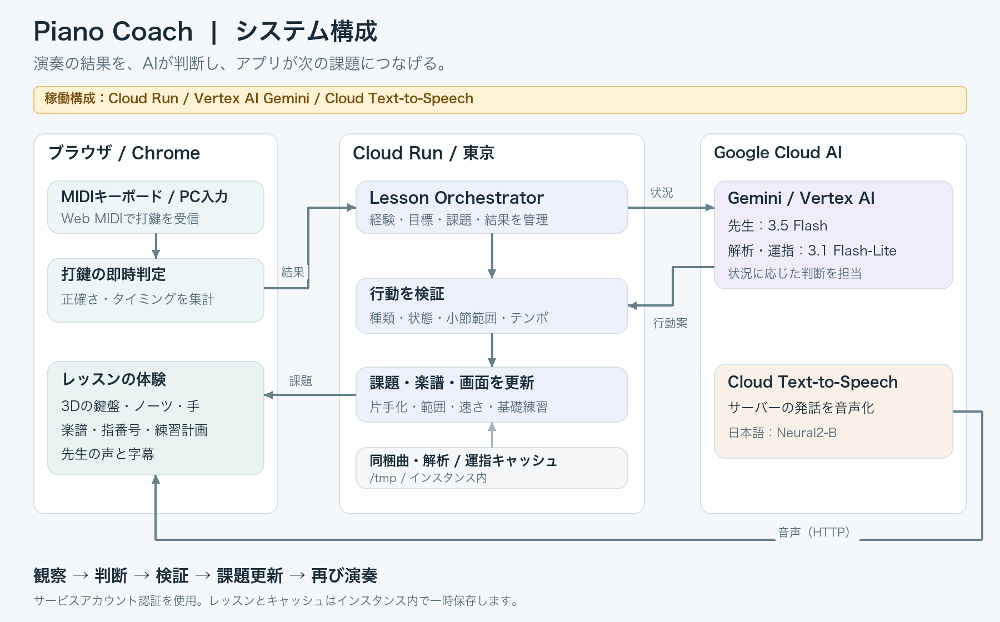
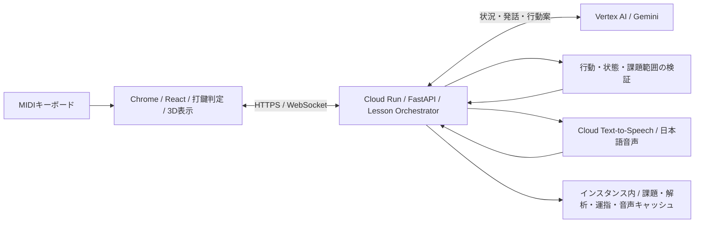

# Google Cloud版の構成とデプロイ

ブランチ：`feat/gemini-cloud-run`。Cloud RunとVertex AI / Cloud Text-to-Speechを使用する。

## このデプロイ

- プロジェクト：`piano-coach-ai-20261015`
- サービス：`piano-coach` / `asia-northeast1`
- 公開URL：<https://piano-coach-149093957006.asia-northeast1.run.app>

先生はGemini 3.5 Flash、曲解析と運指にはGemini 3.1 Flash-Liteを設定している。運指は4小節ずつ生成し、曲の先頭から順に返す。大きな範囲を1回で依頼して最初のお手本が遅れることを避け、各バッチに対して検証と最大1回の修正を行う。

## 構成





Geminiはツールを持たず、先生の発話と限定された行動案を返す。アプリが検証し、music21による課題・楽譜生成と画面の更新につなぐ。即時の打鍵判定はブラウザ側で行う。

## 初回セットアップ

API：`run.googleapis.com`、`cloudbuild.googleapis.com`、`artifactregistry.googleapis.com`、`aiplatform.googleapis.com`、`texttospeech.googleapis.com`、`iam.googleapis.com`。

サービスアカウントはプロジェクト内に2つ作る。

| アカウント名 | ロール |
| --- | --- |
| `piano-coach-runtime` | `roles/aiplatform.user`、`roles/serviceusage.serviceUsageConsumer` |
| `piano-coach-build` | `roles/run.builder` |

プロジェクトを課金先に紐付け、上記API・サービスアカウント・ロールを設定してから、リポジトリルートでデプロイスクリプトを実行する。サービスアカウントの作成直後はIAMへの反映に時間がかかることがある。

## デプロイ

```sh
./scripts/deploy-cloud-run.sh YOUR_PROJECT_ID asia-northeast1
```

Cloud BuildがDockerfileからLinuxコンテナをビルドするため、ローカルのDockerデーモンは不要。Nodeの依存はpackage-lock、Pythonはuv.lockから出力したrequirements.txtを使う。

サービスはHTTPSで公開し、同じホストのWebSocketを許可する。最大1インスタンス、同時リクエスト8、最小0、メモリ1GiB、WebSocketのリクエスト上限3600秒。MIDI機器へのアクセスは利用者のChromeで許可する。

## ローカル起動

```sh
gcloud auth application-default login
export GOOGLE_CLOUD_PROJECT=your-project-id
export GOOGLE_CLOUD_LOCATION=global
export PIANO_COACH_GEMINI_FINGERING_MODEL=gemini-3.1-flash-lite
cd apps/server
uv sync
uv run piano-coach-server
```

別ターミナルで`cd apps/web && npm ci && npm run dev`を実行し、Chromeで`http://127.0.0.1:5173`を開く。

## 設定

| 環境変数 | 役割 / 既定値 |
| --- | --- |
| `PIANO_COACH_BRAIN_PROVIDER` | `gemini` / `codex`。Cloud Runでは`gemini`が既定 |
| `GOOGLE_CLOUD_PROJECT` | Google CloudプロジェクトID（必須） |
| `GOOGLE_CLOUD_LOCATION` | Geminiエンドポイント。既定`global` |
| `PIANO_COACH_GEMINI_MODEL` | 先生のモデル。既定`gemini-3.5-flash` |
| `PIANO_COACH_GEMINI_ANALYSIS_MODEL` | 画像解析用。既定`gemini-3.1-flash-lite` |
| `PIANO_COACH_GEMINI_FINGERING_MODEL` | 運指用。既定`gemini-3.1-flash-lite` |
| `PIANO_COACH_GOOGLE_VOICE` | 日本語の声。既定`ja-JP-Neural2-B` |
| `PIANO_COACH_DATA_DIR` | キャッシュの場所。コンテナでは`/tmp/piano-coach` |
| `PIANO_COACH_ALLOWED_ORIGINS` | 追加のWebSocket Origin。カンマ区切り。通常は同一ホストを自動許可 |
| `PIANO_COACH_VOICE_PROVIDER` | 既定`google`。`irodori`なら従来のローカル音声サーバーを使う |

`/api/health`の`claude`キーは既存フロントとの互換性のために残す。実際のプロバイダとモデルは`brainProvider`・`model`に表示する。このAPIは設定の準備状態を返し、毎回の推論接続テストは行わない。

## 保存と制約

レッスンと課題一覧はメモリ、音声と曲解析は`/tmp/piano-coach`に保存する。キャッシュを取得するHTTPリクエストが同じインスタンスへ到達するよう、単一インスタンス構成とsession affinityを指定している。複数インスタンスへ広げる際は、課題・音声・セッションを外部の共有ストアへ移す必要がある。

現在は複数ユーザー用の永続的な学習記録はない。ページの再読み込みやWebSocketの接続断では、レッスンを開始し直す。Cloud Runの接続タイムアウト後も同様。

## 検証

```sh
cd apps/server && uv run pytest -q
cd apps/web && npm test
cd apps/web && npm run build
cd apps/web && PIANO_COACH_BROWSER_CHANNEL=chrome npx playwright test e2e/lesson.spec.ts e2e/upload.spec.ts e2e/voice.spec.ts
```

公開版の通しテスト（実際のGemini / Cloud TTSを呼び出す）：

```sh
cd apps/web
PIANO_COACH_REAL=1 PIANO_COACH_BROWSER_CHANNEL=chrome \
  PIANO_COACH_BASE_URL=https://YOUR_SERVICE.run.app \
  npx playwright test -c playwright.real.config.ts
```

## 動作確認

1. 公開URLの`/`、`/api/songs`、`/api/health`にアクセスする。
2. 準備画面で先生の声をテストし、`engine: google`の音声が鳴ることを確認する。
3. メヌエットを選び、経験と目標に答える。
4. お手本から演奏、講評と次の課題までを確認する。
5. Cloud Runログで`gemini model=... input_tokens=... output_tokens=...`を確認する。会話内容や認証トークンはログに出さない。

## 参考

- [Vertex AIのGenerateContent](https://docs.cloud.google.com/vertex-ai/generative-ai/docs/model-reference/inference)
- [Gemini 3.5 Flash](https://docs.cloud.google.com/gemini-enterprise-agent-platform/models/gemini/3-5-flash)
- [Cloud Run / FastAPI](https://docs.cloud.google.com/run/docs/quickstarts/build-and-deploy/deploy-python-fastapi-service)
- [Cloud Run / WebSocket](https://docs.cloud.google.com/run/docs/triggering/websockets)
- [Cloud Text-to-Speech API](https://docs.cloud.google.com/text-to-speech/docs/reference/rest/v1/text/synthesize)
